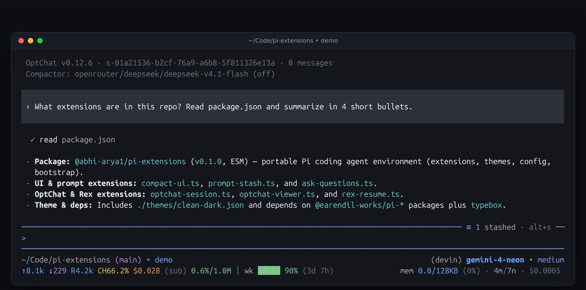

# pi-extensions

Portable Pi coding agent environment — custom extensions, theme, config templates, and bootstrap script so any machine can run the exact same Pi setup and iterate on it directly from git.



## What's inside

```text
.
├── extensions/
│   ├── compact-ui.ts        # Compact tool rendering (bg-highlighted when expanded), thought previews, /clear alias for /new
│   ├── optchat-session.ts   # Per-session OptChat profiles, right-aligned compact footer stats, native compaction events
│   ├── prompt-stash.ts      # Native prompt editor: '>' idle caret (hidden on '!'), inline spinner, persisted interactive stash picker ('≡' badge), compaction border
│   ├── ask-questions.ts     # Restyled interactive structured-question TUI (forked from pi-questions)
│   ├── rex-resume.ts        # OSC 7577 Program Resume reporter so Rex automatically resumes Pi sessions across server restarts
│   └── optchat-viewer.ts    # Read-only OptChat memory timeline overlay (click footer `mem` or `/mem`)
├── themes/
│   └── clean-dark.json      # Ghostty/Rex-inspired dark theme with charcoal surfaces and crisp primaries
├── config/
│   ├── APPEND_SYSTEM.md     # Global system prompt addendum (Executor-first, Executor Skills, gh CLI for GitHub, steering priority)
│   ├── web-search.json      # pi-web-access routing (free Exa default + OpenRouter Responses fallback, no secrets)
│   ├── settings.json        # Portable Pi settings (packages, theme, codemode: on, steering: all, compaction)
│   ├── mcp.json             # Global MCP server definitions (Executor)
│   └── models.json          # Local model provider definitions (llama-cpp)
├── package.json             # Pi package manifest (so this repo is also installable as a Pi package)
└── install.sh               # Idempotent symlink + config-merge bootstrapper
```

## Setup on a new machine

```bash
git clone https://github.com/abhi-arya1/pi-extensions.git ~/Code/pi-extensions
cd ~/Code/pi-extensions
./install.sh
pi update --extensions   # installs external packages from settings.json
```

Then authenticate your providers/MCP as needed (`~/.pi/agent/auth.json` and `~/.pi/agent/mcp-auth.json` are intentionally never tracked in git).

## Iterating locally

`install.sh` symlinks `extensions/*.ts` and `themes/*.json` into `~/.pi/agent/`. Edit files right in `~/Code/pi-extensions`, run `/reload` in Pi, and commit/push when happy.

## Using as a Pi package (optional)

Because `package.json` declares the `pi` manifest, you can also install just the extensions + theme directly via:

```bash
pi install git:github.com/abhi-arya1/pi-extensions
```
